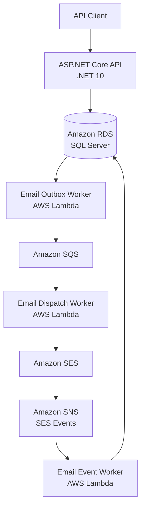

# Portfolio Platform


A production-oriented backend portfolio platform built with **.NET 10**, **Clean Architecture**, and **AWS serverless technologies**.

This project demonstrates modern backend engineering practices including event-driven architecture, asynchronous processing, cloud-native deployment, secure CI/CD automation, and reliable email delivery workflows.

---

## 🚀 Overview

This application provides the backend services for a personal developer portfolio.

The API is designed using Clean Architecture principles with a focus on:

- Separation of concerns
- Maintainability
- Testability
- Cloud-native architecture
- Reliable asynchronous processing

The platform includes a production-grade contact form workflow that processes email requests asynchronously using AWS messaging services.

---

## 🏗️ Architecture



---

# ✨ Features

## Backend

- ASP.NET Core Web API (.NET 10)
- Clean Architecture
- CQRS with MediatR
- Entity Framework Core
- SQL Server / Amazon RDS
- FluentValidation
- Structured logging
- Global exception handling
- Rate limiting
- JWT authentication
- Role-based authorization

---

# 📧 Email Processing System

The contact form uses an asynchronous email pipeline designed for reliability and scalability.

## Workflow

1. API receives contact request
2. Email message is stored in the database
3. Outbox record is created
4. Outbox worker publishes message to SQS
5. Email worker sends message through SES
6. SES publishes delivery events through SNS
7. Event worker updates email lifecycle status

## Reliability Features

- Outbox pattern
- Idempotent message processing
- Processing locks
- Retry tracking
- Dead-letter queue handling
- SES delivery event tracking
- Bounce and complaint processing

---

# ☁️ AWS Infrastructure

This project uses:

| Service | Purpose |
|---|---|
| AWS Lambda | Serverless API hosting and background workers |
| Amazon SQS | Asynchronous message queue processing |
| Amazon SNS | SES email event notifications |
| Amazon SES | Transactional email delivery |
| Amazon RDS SQL Server | Application database and email lifecycle persistence |
| AWS Secrets Manager | Secure application configuration storage |
| IAM OIDC | Secure GitHub Actions authentication and deployment |

The backend consists of multiple Lambda functions:

- Portfolio API Lambda
- Email Outbox Worker Lambda
- Email Dispatch Worker Lambda
- Email Event Worker Lambda
- Email DLQ Worker Lambda

---

# 📂 Solution Structure

```text
Portfolio
├── Portfolio.Api
│   └── ASP.NET Core API
│
├── Portfolio.Application
│   └── Business logic, commands, interfaces
│
├── Portfolio.Domain
│   └── Entities, enums, domain rules
│
├── Portfolio.Infra
│   └── Database, AWS, repositories, services
│
├── Portfolio.EmailWorker
│   └── SQS email dispatch Lambda
│
├── Portfolio.EmailOutboxWorker
│   └── Outbox publishing Lambda
│
├── Portfolio.EmailEventWorker
│   └── SES event processing Lambda
│
├── Portfolio.EmailDlqWorker
│   └── Dead letter processing Lambda
│
└── Portfolio.UnitTests
    └── Automated tests
```

---

# 🔐 Security

Security practices implemented:

- AWS IAM role-based deployment
- GitHub Actions OIDC authentication
- No stored AWS credentials
- AWS Secrets Manager integration
- Input validation
- Rate limiting
- Database connection secret isolation

---

# 🧪 Testing

The solution includes automated tests using:

- xUnit
- FluentAssertions
- Moq
- Lambda-test-tool-10.0
- EF Core SQLite testing provider

Testing covers:

- Email event processing
- Database persistence
- Lifecycle state transitions
- Failure handling

---

# 🚀 Deployment

Deployment is automated through GitHub Actions.

```text
GitHub Actions
       |
       v
OIDC Authentication
       |
       v
AWS IAM Role
       |
       v
Lambda Deployment
```

Deployments are triggered from the `main` branch after successful CI validation.

---

# 🛠️ Tech Stack

## Backend

- C#
- .NET 10
- ASP.NET Core
- Entity Framework Core
- SQL Server
- MediatR
- FluentValidation

## Cloud

- AWS Lambda
- Amazon SQS
- Amazon SNS
- Amazon SES
- Amazon RDS
- AWS Secrets Manager
- IAM

## DevOps

- GitHub Actions
- OIDC Authentication
- CI/CD Pipelines

---

# 📌 Future Improvements

- Additional portfolio API capabilities
- Expanded automated test coverage
- Improved AWS monitoring and observability
- Additional application features and integrations

---

# 👤 Author

**Tony Brill**

Backend-focused full-stack developer specializing in:

- .NET backend development
- Cloud architecture
- AWS serverless applications
- Modern web applications

---

# Acknowledgements

The initial project structure and architectural foundation were inspired by:

[ASP.NET Core CleanArchitecture CQRS Identity](https://github.com/feriel214/ASP.NET-Core-CleanArchitecture-CQRS-Identity)

This repository provided a strong starting point for exploring Clean Architecture principles, CQRS patterns, MediatR-based application workflows, and ASP.NET Core project organization.

The current implementation has been significantly extended and customized with additional features including:

- Upgrade to .NET 10
- AWS serverless deployment architecture
- AWS Lambda-based background workers
- Amazon SQS messaging
- Amazon SNS event processing
- Amazon SES email delivery
- Email Outbox pattern implementation
- Idempotent message processing
- Dead-letter queue handling
- GitHub Actions CI/CD with AWS OIDC authentication
- Production-oriented logging and observability
- Custom authentication and authorization workflows
